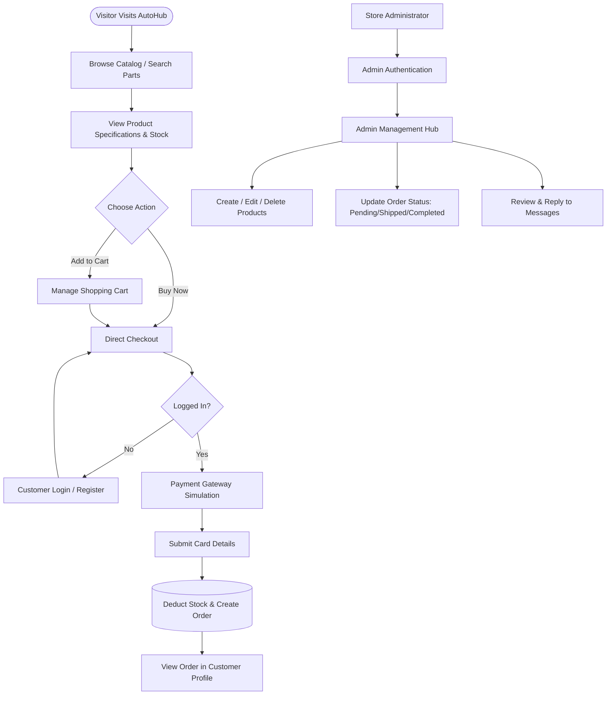
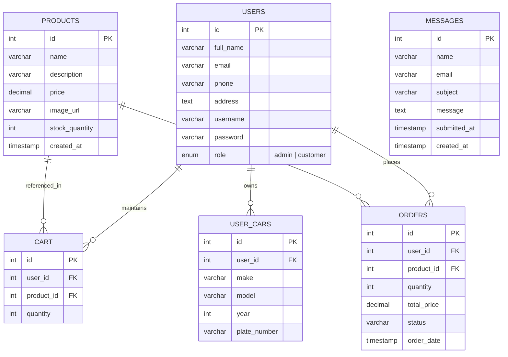

<div align="center">

# 🏎️ AutoHub — Auto Parts Online E-Commerce Platform

<p align="center">
  <strong>A high-performance automotive aftermarket parts & tuning marketplace built for car enthusiasts, track tuners, and daily drivers.</strong>
</p>

[](https://www.php.net/)
[](https://mariadb.org/)
[](https://httpd.apache.org/)
[](https://developer.mozilla.org/)
[](LICENSE)
[](https://github.com/)

<p align="center">
  <a href="#-project-overview">Overview</a> •
  <a href="#-key-features">Key Features</a> •
  <a href="#-system-architecture">Architecture</a> •
  <a href="#-tech-stack">Tech Stack</a> •
  <a href="#-database-design">Database Schema</a> •
  <a href="#-project-structure">Directory Structure</a> •
  <a href="#-installation--setup-guide">Setup Guide</a> •
  <a href="#-default-credentials">Credentials</a> •
  <a href="#-security-highlights">Security</a> •
  <a href="#-roadmap">Roadmap</a>
</p>

---

</div>

## 📌 Project Overview

**AutoHub (Auto Parts Online)** is a full-featured web-based e-commerce platform crafted specifically for the automotive aftermarket and performance tuning industry. Whether an enthusiast is looking for a twin-scroll turbocharger, high-stopping-power Brembo brake kits, titanium exhaust assemblies, suspension coilover setups, or routine maintenance supplies, AutoHub provides an intuitive, high-octane shopping experience.

The platform comes equipped with dual experience pipelines:
1. **Customer Front-Office**: Seamless product discovery, real-time live search, interactive multi-item cart management, instant "Buy Now" checkout, simulated card payment gateway, and self-service account order tracking.
2. **Admin Back-Office**: High-privilege dashboard for inventory stock management, product additions with SQL injection-resistant prepared statements, real-time customer order lifecycle processing, and support communication management.

> [!NOTE]
> Originally engineered as part of the **NIBM Coursework** curriculum, this project demonstrates real-world software engineering fundamentals including session state management, relational database integrity with foreign constraints, secure Bcrypt credential hashing, and responsive UI design.

---

## ⚡ Key Features

### 🛒 Customer Experience
- **Dynamic Product Catalog**: Browse performance tuning parts with high-resolution imagery, pricing in Sri Lankan Rupees (LKR), live stock levels, and descriptive specifications.
- **Instant Search Engine**: Query-based catalog filter (`shop.php?search=...`) to immediately locate parts by keyword or category.
- **Flexible Ordering Paths**:
  - **Direct "Buy Now" Flow**: Jump straight from a product page directly to payment for rapid single-item transactions.
  - **Persistent Shopping Cart**: Add multiple items, adjust line quantities, review subtotals, and trigger cart checkouts.
- **Card Payment Gateway Simulation**: Realistic card processing interface with card number formatting, cardholder validation, MM/YY expiry check, CVV entry, and auto-generated transaction IDs (`TXN-XXXXX`).
- **User Garage & Profile Hub**: View and edit user details (full name, delivery address, phone, email) alongside real-time order tracking with status indicators (`Pending`, `Paid`, `Shipped`, `Completed`).
- **Inquiry & Contact Desk**: Integrated customer support contact form logging directly to the central inbox for team resolution.
- **Secure Authentication**: Toggleable Login and Registration dialogs with frontend and server-side validation (email format, minimum 6-character password rules, phone format verification).

### 🛡️ Admin Operations
- **Restricted Access Dashboard**: Protected admin session authentication with instant access control and route guards.
- **Product & Inventory Management (CRUD)**:
  - Add new products using parameterized SQL prepared statements.
  - Edit existing product names, detailed descriptions, prices, stock levels, and image URLs.
  - Delete retired products with single-click safety confirmation dialogs.
- **Order Fulfillment Center**:
  - Centralized order feed tracking customer name, shipping address, ordered parts, and financial totals.
  - Dynamic status transitions (`Pending` ➡️ `Shipped` ➡️ `Completed`) updated synchronously.
- **Customer Feedback & Inquiries Desk**:
  - Message management center displaying inquiries with one-click direct email response links (`mailto:`) and message pruning.

### 🎨 Design System & UI/UX
- **Dark-Engine Aesthetic**: Deep asphalt dark background (`#121212` / `#1e1e1e`) accented by high-contrast neon racing orange (`#ff4500`).
- **Glassmorphism Navbar**: Sticky, translucent header with `backdrop-filter: blur(10px)`.
- **Card-Based Grid System**: Fully responsive CSS flexbox and grid layouts that scale gracefully from desktop monitors to mobile displays.

---

## 🏛️ System Architecture

### User Journey & Transaction Flow



---

## 🗄️ Database Design

The relational database (`auto_parts_db`) enforces foreign key referential integrity across users, products, orders, shopping carts, and customer vehicle profiles.



### Table Breakdown

| Table | Description | Primary Key | Foreign Keys |
| :--- | :--- | :--- | :--- |
| **`users`** | Customer & Administrator accounts, contact data, hashed passwords, roles | `id` | None |
| **`products`** | Automotive inventory, descriptions, unit pricing, image links, stock level | `id` | None |
| **`cart`** | Temporary shopping cart records tied to specific customer sessions | `id` | `user_id` ➡️ `users.id`<br>`product_id` ➡️ `products.id` |
| **`orders`** | Completed transactions, assigned items, payment status, total in LKR | `id` | `user_id` ➡️ `users.id`<br>`product_id` ➡️ `products.id` |
| **`messages`** | Customer contact form entries submitted to support desk | `id` | None |
| **`user_cars`** | Customer garage profiles (make, model, year, license plate) | `id` | `user_id` ➡️ `users.id` |

---

## 💻 Tech Stack

| Domain | Technology | Description |
| :--- | :--- | :--- |
| **Backend Language** | [PHP 8.x](https://www.php.net/) | Procedural & OOP server scripting, session management, prepared statements |
| **Database Engine** | [MariaDB / MySQL](https://mariadb.org/) | Relational database with InnoDB engine, foreign keys, and indexes |
| **Web Server** | [Apache](https://httpd.apache.org/) | HTTP server module via XAMPP / WAMP / LAMP stack |
| **Frontend Styling** | [CSS3 Modern](https://developer.mozilla.org/) | Custom CSS variables, flexbox, CSS grid, glassmorphic effects, dark theme |
| **Typography** | [Google Fonts](https://fonts.google.com/) | `Poppins` (300, 400, 600, 700 weights) |
| **Security Layer** | [Bcrypt Hashing](https://www.php.net/manual/en/function.password-hash.php) | `PASSWORD_DEFAULT` password encryption & verify routines |

---

## 📂 Project Structure

```bash
AutoPartsOnline/
├── 📜 auto_parts_db.sql       # Complete database dump with tables, relations & sample catalog
├── 📜 LICENSE                 # MIT Open Source License
├── 📜 README.md               # Advanced project documentation & setup manual
│
├── 📁 css/                    # Modular stylesheet directory
│   ├── 🎨 admin.css           # Admin dashboard, inventory tables & order manager styles
│   ├── 🎨 cart.css            # Shopping cart table & summary box styles
│   ├── 🎨 checkout.css        # Order summary & confirmation interface styles
│   ├── 🎨 contact.css         # Support cards, form inputs & status feedback styles
│   ├── 🎨 global.css          # Design system, CSS variables, typography, reset & navbar
│   ├── 🎨 home.css            # Hero section, feature grid & promotional banner styles
│   ├── 🎨 login.css           # Auth card, dual-tab toggle & input styles
│   ├── 🎨 product.css         # Single product view, badge styling & action buttons
│   ├── 🎨 profile.css         # User garage, account updates & order history table
│   └── 🎨 shop.css            # Product grid, search input & catalog card styling
│
└── 📁 php/                    # Backend server application scripts
    ├── ⚙️ db_conn.php         # MySQLi database connection configuration
    ├── 🌐 index.php           # Public landing homepage
    ├── 🛍️ shop.php            # Catalog browser with live search filtering
    ├── 🔍 product_view.php    # Single product showcase with direct buy / add to cart
    ├── 🛒 cart.php            # Cart viewing, line total calculations & item removal
    ├── ➕ add_to_cart.php     # Cart incrementation & session validation endpoint
    ├── 💳 checkout.php        # Order preparation (cart vs single item handler)
    ├── 💰 payment_gateway.php # Banking card simulation UI (Visa / Mastercard)
    ├── ⚡ process_payment.php # Order creation, stock deduction & cart cleanup
    ├── 👤 profile.php         # User profile manager & past order history
    ├── ✉️ contact.php         # Customer inquiry form handler
    ├── 🔑 login.php           # Client-facing login & registration screen
    ├── 🔐 auth.php            # Authentication logic (registration hashing & login verification)
    ├── 🚪 logout.php          # Session teardown & safe redirect
    ├── 🛠️ admin.php           # Admin product manager & inventory dashboard
    ├── 📦 admin_orders.php    # Admin order tracking & shipping status modifier
    ├── 📬 admin_messages.php  # Admin support inbox for received customer queries
    ├── ✏️ edit_product.php    # Product modifier form
    └── 💾 save_product.php    # Prepared statement handler for creating products
```

---

## 🚀 Installation & Setup Guide

Follow this step-by-step walkthrough to get AutoHub running on your local development environment.

### 1. Prerequisites
Ensure you have an active local server environment installed:
- [XAMPP](https://www.apachefriends.org/) (Recommended for Windows / Linux / macOS)
- Alternatively: [WampServer](https://www.wampserver.com/), [MAMP](https://www.mamp.info/), or a native LAMP / LEMP stack.
- **PHP Version**: 7.4 or 8.0+ (8.2+ recommended)
- **Database**: MySQL 5.7+ or MariaDB 10.4+

---

### 2. Clone or Copy the Repository
Place the project inside your local web server's root directory:

**For XAMPP:**
```bash
# On Linux
cd /opt/lampp/htdocs/
git clone https://github.com/<your-username>/AutoPartsOnline.git

# On Windows
# Clone or move the folder into: C:\xampp\htdocs\AutoPartsOnline
```

---

### 3. Database Configuration

1. Launch your MySQL server via XAMPP Control Panel.
2. Open **phpMyAdmin** in your browser: `http://localhost/phpmyadmin`
3. Create a new database named:
   ```sql
   CREATE DATABASE auto_parts_db CHARACTER SET utf8mb4 COLLATE utf8mb4_general_ci;
   ```
4. Select `auto_parts_db`, click on the **Import** tab, and upload [auto_parts_db.sql](auto_parts_db.sql).
5. Execute the import. All 6 tables (`users`, `products`, `orders`, `cart`, `messages`, `user_cars`) and sample catalog parts will be created.

---

### 4. Verify Database Connection Settings

Open [php/db_conn.php](php/db_conn.php) and verify your MySQL credentials and port:

```php
<?php
$servername = "localhost";
$username   = "root";
$password   = "";
$dbname     = "auto_parts_db";

// Connection using port 3307 or 3306
// NOTE: Default XAMPP MySQL port is 3306. Adjust if your installation uses 3307.
$conn = new mysqli($servername, $username, $password, $dbname, 3307);

if ($conn->connect_error) {
    die("Connection failed: " . $conn->connect_error);
}
?>
```

> [!TIP]
> If your local MySQL / MariaDB server runs on default port **`3306`**, update line 8 in `php/db_conn.php` from `3307` to `3306` (or omit the 5th argument: `new mysqli($servername, $username, $password, $dbname)`).

---

### 5. Launch the Application

1. Open your web browser.
2. Navigate to:
   ```http
   http://localhost/AutoPartsOnline/php/index.php
   ```
3. You can now explore the catalog, register an account, add parts to your cart, simulate checkout, and test the admin dashboard!

---

## 🔐 Default Credentials

For evaluation and testing, you can use the pre-configured credentials below:

### 👑 Administrator Account
Access the back-office at `http://localhost/AutoPartsOnline/php/admin.php`:
| Role | Username | Password | Access Level |
| :--- | :--- | :--- | :--- |
| **Admin** | `admin` | `123` | Full Dashboard, Inventory CRUD, Order Management, Messages |

### 👤 Sample Customer Accounts
Available customer accounts populated in [auto_parts_db.sql](auto_parts_db.sql):
| Role | Username | Password (Plaintext) | Email |
| :--- | :--- | :--- | :--- |
| **Customer 1** | `www` | *User Created* | `nimna@gmail.com` |
| **Customer 2** | `me` | *User Created* | `nimn@gmail.com` |

> [!NOTE]
> You can also register any new customer account instantly through the [Login / Register](php/login.php) page.

---

## 🔒 Security Highlights

- **Bcrypt Password Encryption**: User passwords are encrypted using PHP's native `password_hash($password, PASSWORD_DEFAULT)` and verified using constant-time `password_verify()`.
- **Prepared Statements**: Product creation operations in [php/save_product.php](php/save_product.php) use parameterized MySQLi statements (`$stmt->bind_param("ssdis", ...)`) to eliminate SQL injection vectors.
- **Session-Based Access Control**: Sensitive actions (viewing carts, checking out, updating profiles, and admin operations) perform affirmative session validation (`isset($_SESSION['user_id'])`, `isset($_SESSION['admin_logged_in'])`).
- **Input Sanitization**: User-facing queries and error strings utilize `htmlspecialchars()` across output templates to mitigate Cross-Site Scripting (XSS).

---

## 🗺️ Roadmap & Future Enhancements

- [ ] **Vehicle Compatibility Filter**: Utilize the `user_cars` table to filter catalog items based on Year / Make / Model compatibility.
- [ ] **Live Payment Gateway**: Integrate Stripe, PayPal, or PayHere webhooks for actual debit/credit card clearance.
- [ ] **PDF Invoice Generator**: Implement FPDF / Dompdf for instant receipt and invoice downloads.
- [ ] **Automated Mailer**: Integrate PHPMailer to send order confirmation emails and status dispatch updates.
- [ ] **RESTful API**: Expose `/api/v1/products` endpoints for headless mobile app integrations.

---

## 🤝 Contributing

Contributions are what make the open source community such an amazing place to learn, inspire, and create. Any contributions you make are **greatly appreciated**.

1. Fork the Project (`https://github.com/<your-username>/AutoPartsOnline/fork`)
2. Create your Feature Branch (`git checkout -b feature/AmazingFeature`)
3. Commit your Changes (`git commit -m 'Add some AmazingFeature'`)
4. Push to the Branch (`git push origin feature/AmazingFeature`)
5. Open a Pull Request

---

## 📄 License

Distributed under the **MIT License**. See [LICENSE](LICENSE) for full details.

```
Copyright (c) 2026 SANDANIMNE K G L
```

---

<div align="center">
  <sub>Built with ❤️ for automotive tuners, speed enthusiasts, and the NIBM coursework community.</sub>
</div>
